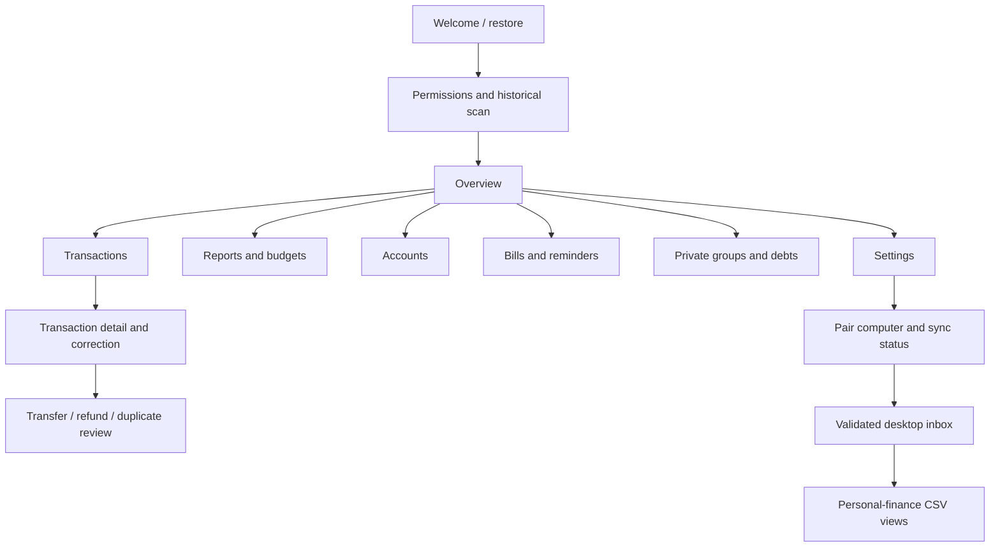

# Greenfield Indian money manager — screen plan and feasibility

Research date: 22 October 2026. Status: implementation plan, not an implementation or verified visual replica.

## Decision

Build an independent Android personal money manager with axio's documented expense-management capabilities, private expense splitting, and automatic delivery into the personal-finance data bank. Start a new project with a distinct application ID so both existing apps remain installed. This document lives in spending-tracker only as a planning artifact; do not replace its implementation or database.

The core app is technically feasible. Reliable ingestion and accounting are the difficult parts, not drawing screens. Full commercial axio parity is a different product: live shared groups need a service; lending and deposit booking need financial partners. Those surfaces are catalogued below rather than silently omitted or represented by nonfunctional buttons.

This is a final proposed scope and build order. Exact current axio layouts remain unverified: its public website and Reddit do not expose every authenticated screen, modal, or version-specific navigation path. Proposed screen names below describe our app, not observed axio routes.

## Evidence and confidence

Evidence labels: **O** = capability documented by axio; **R** = Reddit user report, possibly historical; **P** = our proposed design or improvement. An O label confirms the capability, not a specific layout. All controls, layouts, defaults and acceptance criteria below are proposals unless explicitly described in this evidence section.

### Official baseline

- **O1 — [Axio FAQ](https://www.axio.co.in/faq?f4f96f21_page=2):** Documents Money Manager, account views, cash/wallet expense defaults, manual entries, SMS rescan, unsupported-message reporting, emailed CSV/PDF reports, profile/settings, backup/restore/deletion, and single-device limitations. Groups include private/shared modes, spending on another member's behalf, allocation, chat, owed balances, settlement and owner-managed membership. Some instructions may describe older app versions.
- **O2 — [Google Play listing](https://play.google.com/store/apps/details?id=com.daamitt.walnut.app):** Documents SMS tracking, daily/monthly spending, balances, card dues, utility bills, notes, custom categories, tags, receipt photos and search. Also lists Pay Later, personal loans and fixed deposits. Public promotional screenshot links are available there; they are not an exhaustive authenticated screen inventory.
- **O3 — [Managing Money with axio](https://www.axio.co.in/blogs/managing-money-with-axio):** Describes category budgets, visual progress, overspend alerts, weekly review and recurring bill reminders.
- **O4 — [Splits or splits](https://www.axio.co.in/blogs/splits-or-splits-key-to-successful-bill-splitting):** Describes shared expense contributions and group chat.
- **O5 — [Privacy policy](https://www.axio.co.in/privacy-policy):** Covers the wider finance business. Do not inherit its data practices as our app's requirements. Marketing descriptions and FAQ privacy wording differ; neither substitutes for an app audit.

### Reddit findings and resulting requirements

| Source | User-reported observation | Requirement for our app |
|---|---|---|
| **R1** [Expense tracking, July 2024](https://www.reddit.com/r/personalfinanceindia/comments/1dvdrnj) | Historical and incoming SMS capture; notification opens category/tag/note editing | Fast correction from notifications; useful historical scan |
| **R2** [Daily expense app, October 2024](https://www.reddit.com/r/Frugal_Ind/comments/1g55qlk/app_to_track_daily_expenses/) | Card repayments and other entries can be treated as non-expense | Separate money movement from consumption |
| **R3** [Expense tracker usage, January 2025](https://www.reddit.com/r/personalfinanceindia/comments/1iea1pc) | Accounts, categories, split allocations and owed amounts; manual cash/descriptions | Editable merchants, cash ledger and private split accounting |
| **R4** [Tracking and categorisation, 2024](https://www.reddit.com/r/IndiaInvestments/comments/1ad24wn/suggest_best_app_to_track_expenses_and_categorize/) | Complaints about split purchases inflating personal spend and refund linkage | Personal share and reimbursements must reconcile independently of cash flow |
| **R5** [Tracker feedback, August 2025](https://www.reddit.com/r/Frugal_Ind/comments/1mn7712/building_a_new_custom_expense_tracker_need_your_input/) | Repeated manual categorisation is burdensome | Bulk editing and merchant rules, explicitly improvements |
| **R6** [Axio disadvantage, July 2026](https://www.reddit.com/r/personalfinanceindia/comments/1v7wf8l/axio_my_experience_the_one_big_disadvantage/) | Multi-category filtering and investment/spending separation requested | Include/exclude multiple categories; investment flows separate from consumption |
| **R7** [CSV export thread, 2023–2024](https://www.reddit.com/r/personalfinanceindia/comments/13g7bt6) | Reports conflict over removal and later return of CSV | Use official export documentation for current claims; make our export independent of a vendor service |
| **R8** [Budgeting apps, September 2024](https://www.reddit.com/r/personalfinanceindia/comments/1fi9u4e) | Manual mode and complaints about financial-product cross-selling | Manual mode remains usable; expense tracking is the primary experience |
| **R9** [Household tracking, January 2026](https://www.reddit.com/r/indiasocial/comments/1q2ot41/shared_expense_tracking_app_for_a_household_that/) | Household reporting differs from settlement-oriented splitting | Do not confuse group debt balances with household budgets |

These are qualitative reports, not a representative survey or proof that every issue persists. No current full-screen tour was found. No private APK, account, device data or network traffic was inspected.

## Product contract

- Android first, INR and Indian number formatting; IST display with original timestamps retained. Calendar months by default; configurable budget start day and April–March reports.
- Local encrypted ledger; no registration required for personal use. SMS optional, manual and CSV modes always available. Gmail is an optional later ingestion source, not required for core parity.
- No raw SMS/email body persistence, analytics or advertising. Receipts are explicit user attachments, encrypted and excluded from repo sync by default.
- One phone owns ledger edits in the initial release. The personal-finance repo receives a derived copy; it is not a second transaction editor.
- Functional parity rather than copied branding, illustrations or undocumented private API dependence.
- All following IDs are planned navigable surfaces, including sheets and dialogs. They do not imply one Activity or implementation file each.

## Navigation

Five main destinations: **Overview · Transactions · Accounts · Bills · Groups**. Overview links to reports and budgets. Settings is available from the top bar; search and add-entry are readily accessible from ledger destinations. Every chart drills into the same filtered transaction list.



## Complete planned screen inventory

Milestones: **A** = first vertical slice; **B** = dependable daily tracker; **C** = personal money-management parity; **D** = optional live collaboration. A–C define the complete personal app release. D requires a separate shared-service decision.

### Setup, permissions and recovery

| ID | Surface | Contents and actions | Basis / stage |
|---|---|---|---|
| S01 | Welcome | New ledger, import axio CSV, restore encrypted backup; explain local storage | P / A |
| S02 | Permission explanation | Explain transactional SMS access; grant or continue manually | O2 + P / A |
| S03 | Scan setup | Date range, expected source coverage, start/cancel | R1 + P / A |
| S04 | Scan progress/results | Scanned/imported/duplicate/review/error counts; interrupted-scan resume | P / A |
| S05 | Detected account review | Name and confirm accounts; distinguish banks/cards with identical suffixes | P / A |
| S06 | Import wizard | File picker, format/column mapping, date/amount interpretation, preview, duplicate review, atomic confirmation, result | O1 export + P / A |
| S07 | Restore wizard | File/password, validate, preview replacement scope, explicit confirmation, result | O1 + P / B |
| S08 | Unlock | System device credential/biometric; lock timeout and failure recovery | P / B |

Android's permission prompts, document/photo pickers and biometric dialog remain system surfaces, not custom copies. Permission denial, permanent denial, empty inbox and revoked access have explicit recovery actions.

### Daily overview, transactions and corrections

| ID | Surface | Contents and actions | Basis / stage |
|---|---|---|---|
| S09 | Overview | Month selector; spending, income and cash-flow totals; budget progress; recent entries; dues; review/sync freshness | O2/O3 + P / A |
| S10 | Period picker | Month, custom range and financial year; shared across views | P / A |
| S11 | Transaction timeline | Date groups, totals, pagination, review badges, add/search/filter, multi-select | O2 + P / A |
| S12 | Search | Merchant, description, category, tags and notes; matching amount/date filters | O2 + P / B |
| S13 | Filter/sort sheet | Multi-account/category/tag include/exclude, amount, status, type, source, reviewed state; clear filters and visible filtered totals | R6 + P / B |
| S14 | Transaction detail | Money movement, personal expense contribution, account, status, provenance, related entries, notes/tags/attachments; edit/link/exclude/delete | O2/R2/R4 + P / A |
| S15 | Add/edit transaction | Amount, debit/credit/classification, account, date/time, merchant, category, tags, note; optional split and receipt | O1/O2 + P / A |
| S16 | Category picker/manager | Search/create/edit/archive categories; preview impact of reassignment | O2 + P / B |
| S17 | Tag picker/manager | Multiple tags, rename/merge with preview, tag-filtered ledger | O2 + P / B |
| S18 | Merchant detail/rule | Alias for opaque UPI names; related history; apply category rule to future or selected historical entries | R1/R3 + P / B |
| S19 | Receipt viewer | Attach via picker/camera, zoom, remove; attachment failure/recovery | O2 + P / C |
| S20 | Bulk action sheet | Category/tag/exclusion edits, selected count/total, preview and undo | R5 + P / B |
| S21 | Needs review | Ambiguous parse, possible duplicate, unmatched transfer/refund, uncertain account; resolve/ignore | P / A |
| S22 | Link entries | Candidate transfers/card repayments/refunds/reimbursements; compare evidence, link/unlink, allow no match | R2/R4 + P / B |
| S23 | Duplicate comparison | Keep both or merge source evidence; retain manual corrections; undo | P / B |
| S24 | Delete/undo confirmation | Scope, related split/link effects; deletion tombstone for sync; rescan must not resurrect deleted entries | P / B |

Notification tap opens S14/S15 for the specific entry. Notifications hide sensitive content by default; denied notification access does not block ingestion. Failed/pending/reversed alerts remain inspectable but do not silently inflate posted spending.

### Accounts and balances

| ID | Surface | Contents and actions | Basis / stage |
|---|---|---|---|
| S25 | Accounts | Banks, cards, cash, wallets and meal cards; archived filter; last-observed balance/time | O1/O2 + P / A |
| S26 | Account detail | Account ledger, observed balance, inflow/outflow, card bill link, add entry, edit/archive | O1/O2 + P / A |
| S27 | Account editor/settings | Type/name/institution/suffix; cash defaults; opening balance; repo account mapping | O1 + P / B |
| S28 | Balance reconciliation | Observed versus calculated values, as-of date, missing-history warning, explicit adjustment | P / B |
| S29 | Account identity resolution | Resolve collisions/aliases; preview reassignment before merge; cannot merge bank and card accidentally | P / B |

Never identify an account solely by its last four digits. Never label SMS-derived balances as live bank balances. Cash withdrawals and wallet loads become transfers; actual cash purchases count once.

### Reports and budgets

| ID | Surface | Contents and actions | Basis / stage |
|---|---|---|---|
| S30 | Spending reports | Daily/monthly bars, category breakdown, merchant totals, gross spending/refunds/net spending, explicit scope | O2/O3 + P / B |
| S31 | Report drill-down | Category/merchant/tag comparison and matching transaction list; same period and filters | P / B |
| S32 | Budgets | Monthly overall and category limits, spent/remaining, overspend, uncategorised coverage | O3 + P / C |
| S33 | Budget editor | Amount, category, start day, notification preference; next-period carry-forward of settings | O3 + P / C |
| S34 | Monthly review | Unreviewed entries, missing balance history, anomalous changes, budget summary, sync status; no invented financial advice | P / C |
| S35 | Export report | Date/accounts/types/fields, CSV or PDF, preview, save/share, success/failure | O1 + P / A CSV, C PDF |

### Bills, cards and recurring obligations

| ID | Surface | Contents and actions | Basis / stage |
|---|---|---|---|
| S36 | Bills | Upcoming/overdue/paid, utilities and cards, amount/due date and freshness | O2/O3 + P / C |
| S37 | Bill detail | Biller/card, total/minimum due where known, source date, due date, linked payment, edit/remind | O2 + P / C |
| S38 | Add/edit recurring bill | Frequency, next date, amount or unknown amount, account, reminder schedule, pause | O3 + P / C |
| S39 | Payment matching | Match existing ledger entry or record payment; distinguish user-marked paid from verified match | P / C |

These track obligations. They do not initiate bank payments. A transaction alert does not prove a statement is complete; stale dues stay labelled. No invented autopay state or guaranteed exact-time notification.

### Groups, splits and informal debts

| ID | Surface | Contents and actions | Basis / stage |
|---|---|---|---|
| S40 | Groups | Private groups, total you owe/owed; create group | O1/R3 + P / C |
| S41 | Group creation/settings | Name, manually entered participants, archive; private mode explained | O1 + P / C |
| S42 | Group detail | Expense/settlement activity, member balances, add expense, settle, member breakdown | O1/R3 + P / C |
| S43 | Split editor | Payer including another member; equal/custom/percentage shares; exact remainder allocation and total validation | O1/R3 + P / C |
| S44 | Person balance | Owed/owing entries and settlements within/across private groups | O1 + P / C |
| S45 | Settlement | Record amount/date/from/to, match transfer, partial settlement, correction | O1 + P / C |
| S46 | Group lifecycle confirmation | Remove member/archive/delete; outstanding balances visible; no silent loss | O1 + P / C |
| S47 | Shared-group sign-in/invite | Optional identity, invitation, consent, acceptance/decline, blocked/expired invite | O1 capability; layout P / D |
| S48 | Shared activity/chat | Expense updates and messages, offline/pending/failed sends, conflict resolution | O1/O4 + P / D |
| S49 | Shared membership/settings | Owner permissions, remove/leave, unsettled balance warning, access revocation | O1 + P / D |

Private splits are fully on-device and do not notify anyone. They are not live shared groups. Shared groups must never automatically expose the user's entire personal ledger. Household joint reporting beyond group shares is a separate later feature, not assumed axio parity.

### Settings, ingestion, backup and repo sync

| ID | Surface | Contents and actions | Basis / stage |
|---|---|---|---|
| S50 | Settings | Sources, rules, display, budgets/notifications, security, backup, import/export, sync, help | O1 + P / A |
| S51 | SMS source/status | Permission, last successful scan, range/rescan, battery restriction help, ingestion counts | O1 + P / A |
| S52 | Unrecognised-message review | On-demand transient view from inbox, manual entry/rule correction; no body stored or uploaded | O1 reporting concept + P / B |
| S53 | Rules manager/editor | Narrow sender/merchant rules, order, enable/disable, preview on synthetic data; user overrides win | R1 + P / B |
| S54 | Backup | Encrypted export, last backup, restore entry point, password-loss explanation | O1 + P / B |
| S55 | Privacy/security | App lock, notification redaction, exported-field explanation, clear local data with confirmation | P / B |
| S56 | Display/notification preferences | Theme, Indian grouping, budget day, due-date reminders and thresholds | P / C |
| S57 | Pair computer | Receiver address and one-time QR pairing; confirm destination and identity | P / A |
| S58 | Repo mappings | Local account/category mapping to personal-finance IDs; unresolved mapping preview | P / A |
| S59 | Sync status/history | Pending/acknowledged/rejected revisions, last success, retry/pause, manual sync, actionable error | P / A |
| S60 | Sync issue detail | Invalid mapping/schema, unreachable receiver, conflict, pairing revoked; retry/re-pair; retain queued changes | P / A |
| S61 | Help/about/diagnostics | Version, permissions guide, accounting definitions, sanitized diagnostics; no raw bodies or credentials | P / B |
| S62 | Gmail connection/status | Optional user-owned OAuth setup, read-only consent, query/range, sync/reconnect/revoke | P / later ingestion extension |

Use shared empty/loading/error/offline components and retain filters/navigation on return. Charts require text totals, non-colour-only states, TalkBack labels, scalable text and usable touch targets. No fake success when imports, backups or sync fail.

## Commercial axio surfaces — inventory and feasibility boundary

The store listing confirms these product families; FAQ text supplies some actions. The route breakdown below is inferred, not a verified screen tour. They are outside A–D and must not become placeholder buttons in the personal app.

| Family | Surfaces an actual implementation would require | Assessment |
|---|---|---|
| Identity/KYC | Mobile verification, profile, PAN/KYC, selfie/document capture, verification status, consent/documents | Not needed for local ledger; partner-specific for financial services |
| Pay Later | Eligibility/offer, limit, purchases, order/EMI detail, dues, repayment history, blocked status, closure | Requires lender integration; not reproduced by UI alone |
| Personal loan | Application, eligibility/offer, disclosure/terms, KYC, agreement, disbursal, repayment schedule, servicing/closure | Separate financial-service business, not a personal app feature |
| Mandates/payments | Bank selection, mandate consent/setup, pending/success/failure, management/cancellation, receipts | Requires supported payment/provider integrations |
| Fixed deposits | Providers/rates, tenure/amount quote, depositor/nominee details, KYC, funding/status, holdings dashboard, FD advice, withdrawal/closure | Booking depends on partner APIs and onboarding; manual FD tracking could be added separately |
| Support | Product support, grievances, account deletion and financial documents | Personal app gets local help; no claim to service third-party financial products |

## Accounting contract — required before UI implementation

1. Store money in integer paise; original currency/amount and explicit conversion when present. Never guess exchange rates. Date-only imports preserve their reduced precision.
2. Distinguish expense, income, own-account transfer, card repayment, investment movement, refund and reimbursement. Keep source event status separate from classification.
3. One economic transaction may have several alert observations. Deduplicate strong matching references with account/type evidence. Same amount/time alone is insufficient; ambiguity enters review.
4. Manual corrections survive rescans. Deleted entries leave tombstones. Linking is reversible and retains provenance without storing message bodies.
5. Card purchase contributes to spend; its repayment moves money between bank and liability accounts. ATM withdrawal funds cash; the later cash purchase is consumption.
6. Refunds link to purchases where possible, including partial/later-period refunds. Show gross/refunds/net in the refund's actual period; original-period adjusted reporting must be a separate labelled view.
7. A split purchase retains full bank outflow but only the user's share counts as personal expense. A later reimbursement settles a receivable, not salary/income. Expenses paid by another member affect the user's payable without inventing a bank debit.
8. Balance observations carry source and timestamp. Calculated balances require a known starting balance and coverage; missing data stays unknown, never zero.
9. Explicit rounding allocation makes split shares sum exactly. Pending/failed/reversed states and duplicate evidence never add multiple posted expenses.

## Repo-sync design and compatibility

Inspected read-only: personal-finance's `data/README.md`, CSV headers, `finance/csv_store.py` and CLI. It currently has price refresh, not a transaction importer. Its existing transaction header is:

```text
date,account_id,category,subcategory,direction,amount_inr,description,tags
```

It lacks a stable transaction key, revision, classification and deletion metadata. Its price CSV helper preserves old non-empty values; that is unsuitable for clearing edited notes/categories and transaction tombstones. Do not blindly reuse it for ledger sync.

**Chosen first transport: paired desktop receiver on a private reachable network.** The phone never holds GitHub credentials. Local capture works without the receiver; delivery resumes when the computer is reachable. Secure remote connectivity is a later deployment choice, not an assumption that the laptop is always online.

Flow:

1. The phone commits each ledger edit and a pending change record atomically in Room.
2. A network-constrained worker sends bounded batches over authenticated TLS. First-use QR pairing pins the receiver identity; store the revocable pairing secret encrypted via Keystore.
3. Each payload includes schema version, device/ledger ID, transaction UUID, increasing revision, classification, source type, account mapping, normalized fields and deletion tombstone. It excludes message bodies, full account numbers, receipts and credentials.
4. Receiver validates the complete batch, applies it transactionally to a local SQLite inbox, and acknowledges only durable writes. Replayed UUID/revision pairs have no additional effect; stale revisions are ignored or reported.
5. A deterministic importer materializes app-owned rows with `source`, `source_id`, `revision`, classification and inclusion metadata. Preserve hand-entered rows and avoid changing their historical meaning. Keep raw cash-flow and personal-spending views distinct so transfers/splits are not misread as expenses.
6. Write CSV updates using a temp file and atomic replacement. Serialize writers; never accept arbitrary destination paths from the phone. Keep a recoverable previous generation.
7. A successful sync means durable local receipt; separately show whether the derived CSV is updated. Git commit/push is a separate user-approved integration, not silently part of phone sync or a promise to bypass protected branches.

For the first importer, retain the existing CSV columns and append source metadata only after checking every actual consumer. A source mapping table reconciles app accounts/categories to repo identifiers. Matching imported history against existing manual rows is a review step, not amount-based automatic merging. Import and display explicit transfers/card repayments without feeding them into personal-consumption totals.

A fully unattended hosted GitHub transport is technically possible with repository Contents write permission, but it broadens phone credential access and creates remote-write/branch-policy concerns. It is not the initial default. [GitHub Contents API](https://docs.github.com/en/rest/repos/contents).

## Feasibility assessment

| Capability | Verdict | Evidence or limiting factor |
|---|---|---|
| Compose screens, reports, local accounts/budgets | Feasible | Current project already uses Kotlin/Compose/Room; greenfield implementation can use the same platform without carrying its UI/schema forward |
| SMS history and incoming capture | Feasible with coverage limits | Android permission + receiver; templates change and alerts can be absent. Never promise every bank or transaction |
| Reliable own-bank parsing | Feasible after evidence-driven tests | Synthetic fixtures per institution; unknown formats and ambiguous transfers require review |
| Axio-perfect categorisation | Not established | No access to its model/rule corpus; learn user aliases/rules locally and measure error rate |
| Exact current visual clone | Not established | Public references incomplete; requires current device walkthrough and original replacement assets |
| Balances/card dues from SMS | Partial | Last-observed information only, not a guaranteed current ledger/statement |
| Native local encrypted storage/backup | Feasible | Current project demonstrates SQLCipher/Keystore/encrypted backup patterns; greenfield still needs its own recovery checks |
| Repo sync | Feasible, conditional on connectivity | Durable outbox + paired receiver + idempotent importer; delivery delayed while computer unreachable |
| Background monthly/daily execution | Eventual, not exact-time | WorkManager is deferred by constraints and battery optimisation; foreground catch-up/manual retry required |
| Private expense groups | Feasible offline | Local split/debt accounting and rounding tests |
| Live shared groups/chat | Feasible with added service | Identity, authorisation, delivery/conflicts, data deletion and operations required |
| Account Aggregator access | Not a personal-app shortcut | FIU participation requires regulated-entity eligibility/integration; do not treat as an open bank API |
| Lending/FD booking | Not standalone parity | Requires providers, their credentials/contracts and operational processes |
| Gmail ingestion | Feasible, optional | OAuth configuration and permission lifecycle; do not make core tracking depend on restricted-scope approval |
| Play distribution | Conditional | SMS money-management exception exists, but declaration/review is required; sideload-first does not establish store approval |

Platform sources: [Android periodic work](https://developer.android.com/reference/androidx/work/PeriodicWorkRequest), [SMS policy](https://support.google.com/googleplay/android-developer/answer/10208820), [Sahamati FIU eligibility](https://sahamati.org.in/financial-information-user-fiu/).

## Implementation order and gates

### A — Prove the reason for building it

New app skeleton, encrypted ledger, setup/manual entries/historical scan, account review, overview/timeline/detail/editor, CSV migration/export, receiver pairing, account mappings, sync status and a synthetic end-to-end desktop import. Build a minimal working version of S01–S06, S09–S11, S14–S15, S21, S25–S26, S35, S50–S51 and S57–S60.

Gate: two distinct same-amount transactions remain distinct; replay produces no duplicates; category edits and deletion reach the repo; a receiver outage loses nothing; existing manual CSV rows remain untouched. Device test after permission denial, process restart and network interruption. Prove pairing/TLS on the actual phone and laptop before polishing screens.

### B — Trustworthy daily use

Complete correction flows, search/filters, categories/tags/rules, dedup/linking, reconciliation, bulk edits, encryption recovery and migration. Gate: card repayment, cash funding, failed/reversed payments, partial refunds and split-related source links cannot inflate totals. Finish the corresponding B surfaces above.

### C — Full personal money-management scope

Reports/budgets, bills and recurring reminders, receipts, monthly review, PDF reports and private groups/splits. Gate: budget/report totals match the filtered ledger; split shares reconcile to paise; reimbursement does not become income; paid bills retain evidence state. Finish every A–C screen and its empty/error/permission/offline state.

### D — Optional live social parity

Only after local use is reliable: shared identity/invitations, service-backed groups/chat, authorisation and member lifecycle. Gate: no cross-group or personal-ledger leakage, duplicate updates are harmless, offline edits reconcile, removal revokes access. Until implemented, the app must call groups private and local.

### Release validation

- Synthetic parser/accounting tests; schema and migration tests; encrypted backup round-trip; malicious/invalid receiver payload rejection; CSV quoting/formula-safe presentation exports; replay/out-of-order/deletion sync tests.
- Compose navigation/accessibility checks for all surfaces; large fonts, dark/light, notification deep links, process death and denied permissions.
- Real Android device checks for SMS delivery, reboot/force-stop recovery, battery restrictions, Keystore behaviour and background delivery. Emulators alone cannot establish this reliability.
- Parallel trial against axio and bank records on-device. Keep any real financial records out of fixtures, logs and the app source repository. Repo sync contains only the normalized data the user elects to store in the private data bank.
- No timeline promise yet: A is a medium integration task; B and C are large product milestones; D is a separate service-backed product. Estimates become credible only after the A hardware/sync/parser tests.

## Verification still required

1. Capture a current axio walkthrough of onboarding, home, account detail, transaction edit, search/filter, category budget, bills, groups, export and settings. Record app version and classify discrepancies against O/R/P. This verifies visual parity; it does not block the independent design above.
2. Inspect an axio CSV header/format without copying real transaction rows into this repository. Determine whether categories, tags, manual entries and excluded entries survive migration.
3. Audit all personal-finance CSV consumers before changing its schema. Only headers and the current price helper were assessed here.
4. Confirm target phone/Android version, bank/card coverage and paired-computer availability during the first implementation milestone.
5. Choose product name/application ID and the new project directory at implementation time. No new repo, external write, remote configuration, financial account connection or application code was created during this research.

## Completion criteria

The personal app is complete when all A–C surfaces work; daily capture and review are reliable for the user's measured bank/card coverage; totals reconcile across reports, splits and repo projections; corrections/deletions sync safely; and data can be recovered on a replacement device. It is not honestly a full commercial axio clone until shared-service and financial-product capabilities are independently implemented with their actual dependencies.
